# Big Day Stories

**Bedtime stories that get a child ready for a big day, and show the parent what to say.**

Short personalised stories for children aged 2 to 12 (core age 3 to 8) before a dentist visit, a first day at school, a flight or any of 15 big days. Each evening brings one chapter, the child's own questions are answered inside the story, and the parent sees what worries the child and the words that help.

**Live app: [bigdaystories.up.railway.app](https://bigdaystories.up.railway.app)** · no sign-up needed · tap **Try a sample** for the 3-minute jury tour

Built for Business Cup 2.0 (Nazarbayev University, November 14-15, 2026). Track: **Skills**. Audience: US parents aged 25-45.

**Team Chunky:** Adil Tatiyev, Amir Shamelov.

<p align="center">
  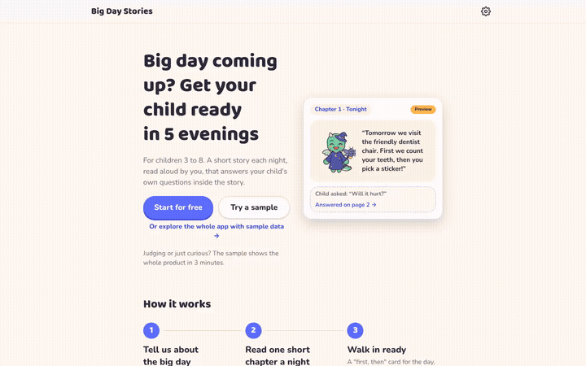
</p>

Full walkthrough video: [laptop](docs/media/video/demo-walkthrough.mp4) · [phone](docs/media/video/demo-walkthrough-phone.mp4) · Pitch deck: [PDF](docs/pitch/deck/big-day-stories-deck-en.pdf)

---

## Contents

- [The problem](#the-problem)
- [How it works](#how-it-works)
- [Features](#features)
- [Screens](#screens)
- [For the jury: the whole product in 3 minutes](#for-the-jury-the-whole-product-in-3-minutes)
- [Business model](#business-model)
- [Architecture](#architecture)
- [Reliability: what happens when something fails](#reliability-what-happens-when-something-fails)
- [Safety and privacy](#safety-and-privacy)
- [Run it locally](#run-it-locally)
- [Deploy](#deploy)
- [Tests](#tests)
- [Repository layout](#repository-layout)
- [Documentation](#documentation)

---

## The problem

Sarah's son Max is 4. On Friday he sees the dentist, and last time he screamed in the waiting room. Sarah finds generic tips and a cartoon where everything ends well, but she does not know what exactly Max is afraid of or what to say to him.

- **1 in 3 preschoolers is afraid of the dentist** (36.5%, Grisolia et al., International Journal of Paediatric Dentistry, 2020, meta-analysis of 50 studies).
- **11% of US children aged 3-17** have diagnosed anxiety (CDC, NSCH 2023-2024); **1 in 31** has autism (CDC ADDM, 2025). For these families a big day comes every week.
- Books and videos are the same for every child. AI story apps write one tale and forget it. A general chatbot needs a prompt every time, remembers nothing and does not guide the parent.

## How it works

1. **The parent describes the big day**: what it is, when, the child's first name or nickname, age, and what worries them. The app builds a plan of evening chapters with a countdown ("5 sleeps until the dentist").
2. **Every evening the child reads one chapter with a story friend** (a parent can also start the next chapter right away once the earlier ones are read). When the child asks "Will it hurt?", the next page of the story answers that question. The parent panel shows what is on the child's mind and the words to say.
3. **On the day and after it**: a "first, then" card for the morning (printable A5 PDF), a 30-second check-in, a bravery badge, and the next big day with the form already filled in. The app remembers what helped this child and uses it next time.

## Features

**Story and reader**
- **15 big-day scenarios**: dentist, shot, blood test, doctor check-up, hospital, haircut, first day at school, flight, moving house, new sibling, new babysitter, sleepover, party, swimming lessons, and a custom big day.
- **Sentence-by-sentence reader** with a progress bar, text sizes, easy-read letters, day and night colours, and a full-screen mode.
- **The child's questions change the story**: three suggested questions per page plus "Ask your own" by typing or by voice; the next page answers it and shows "Updated because Max asked".
- **Read aloud**: the device voice, or premium storyteller voices (Owl the Storyteller, Kind Friend, Moon Storyteller), with highlighting sentence by sentence.
- **A parent's own voice as the storyteller**: record a short sample with consent, and the story is narrated in that voice; one tap deletes it.
- **Story options** for parents: 7 kinds of story (bedtime, funny adventure, discover & grow, moral values, fairy tale, brave hero, social story), length, number of evenings, moments to include, companions, comfort object, interests and words to avoid.

**Child's world**
- **16 story friends** (Moon Bunny, Ember Fox, Puff Dragon, Frost Yeti and more) that the child builds and dresses up with colours, clothes, hats, extras and a buddy; the friend appears in every story.
- **Duolingo-style home**: a path of chapters, today's tasks, evening streaks, stars and levels, badges, a library of read stories, and switching between children (up to 6 saved profiles).
- **Bedtime routine timer**: bath, teeth, pyjamas, story, lights low.

**Parent**
- **Parent panel behind a parent lock**: "What's on Max's mind", each worry with the words to say, what helped last time, and tonight's parent skill.
- **Event day**: a "first, then" card, a printable A5 PDF, calendar reminders (.ics file and Google Calendar link).
- **After the event**: check-in ("How did it go?" and "What helped?"), a badge, a share card, and three suggested next big days.
- **Reminders**: installable PWA with web push and in-app reminders, works offline.
- **Four colour palettes** in day and night versions.

**Business**
- **Paywall** after chapter 1: **Big Day Pass $9.99 once** or **Gold $49 a year** ($7.99 a month), real **Stripe Checkout in test mode**, customer portal, upgrade offer after the check-in.
- **Jury demo mode**: a sample family, a guided six-step tour that ticks itself off, time travel (Evening 2, Event day, After the event), "Skip payment (demo access)" and "Reset demo".

## Screens

<table>
  <tr>
    <td align="center">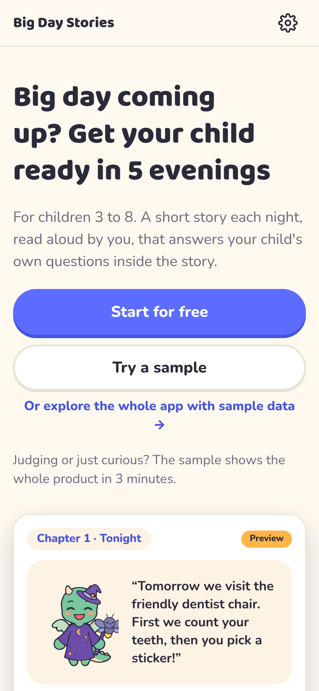<br><sub>Landing</sub></td>
    <td align="center">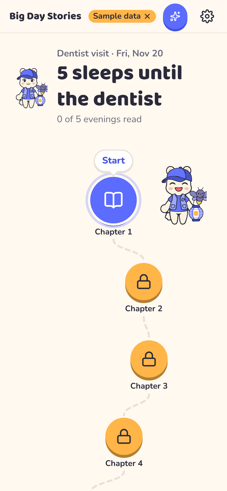<br><sub>Plan with a countdown</sub></td>
    <td align="center">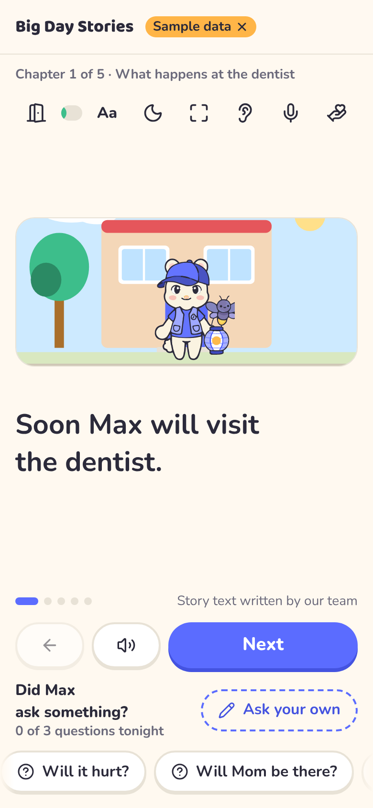<br><sub>Reader and questions</sub></td>
    <td align="center">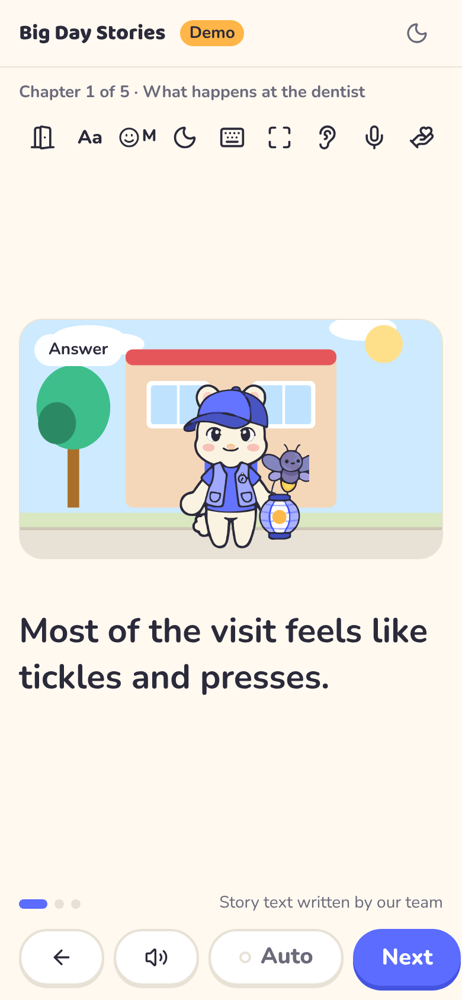<br><sub>The next page answers</sub></td>
  </tr>
  <tr>
    <td align="center">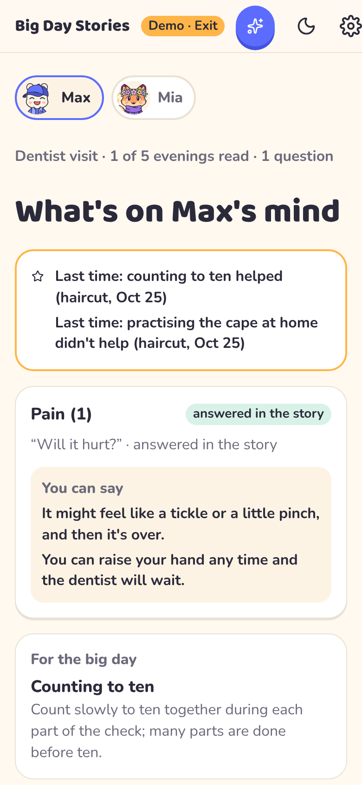<br><sub>Parent panel</sub></td>
    <td align="center">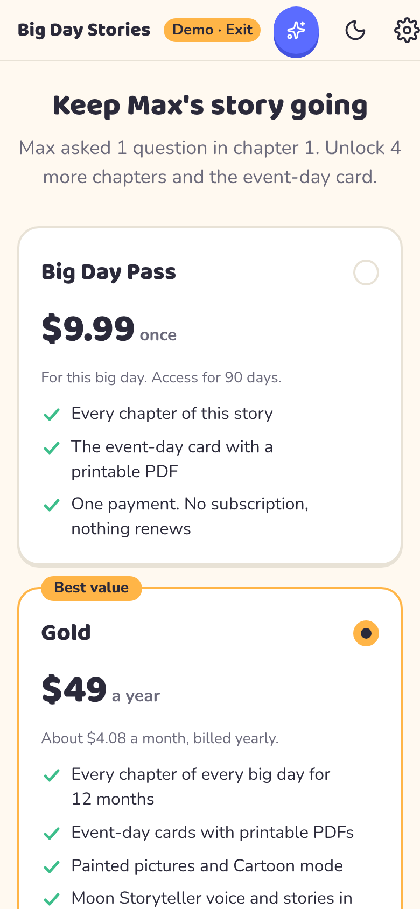<br><sub>Paywall</sub></td>
    <td align="center">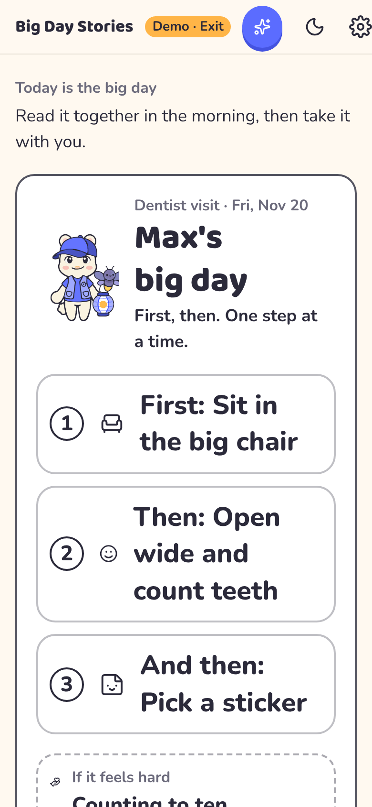<br><sub>Event-day card</sub></td>
    <td align="center">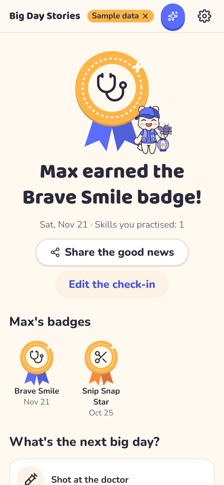<br><sub>Badge after the check-in</sub></td>
  </tr>
  <tr>
    <td align="center">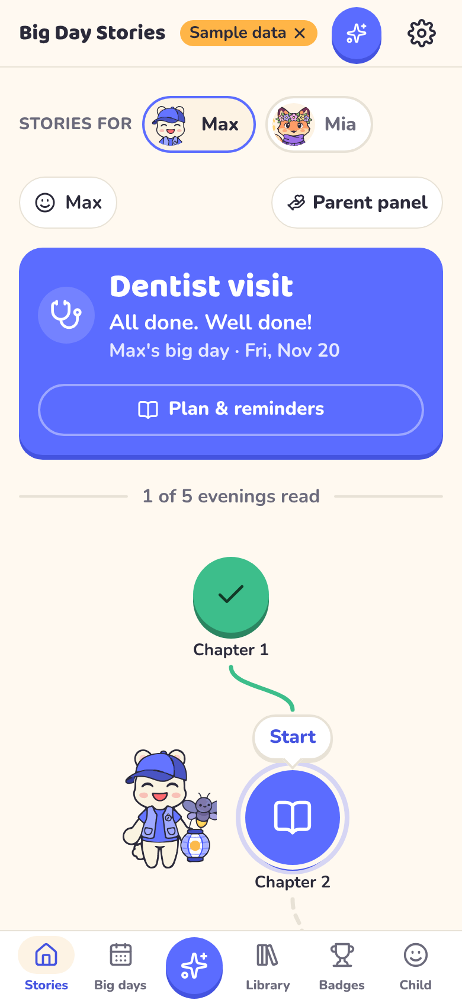<br><sub>Home path</sub></td>
    <td align="center">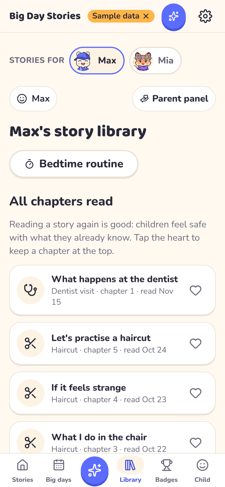<br><sub>Story library</sub></td>
    <td align="center">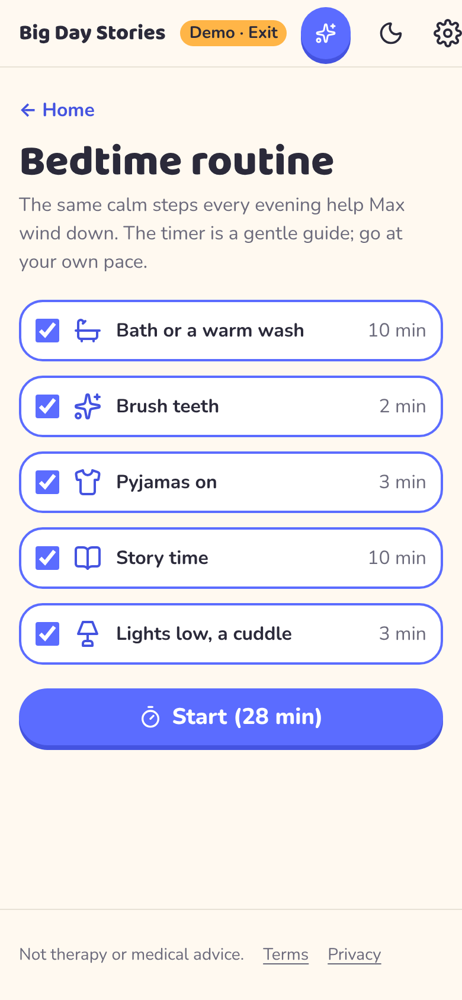<br><sub>Bedtime routine</sub></td>
    <td align="center">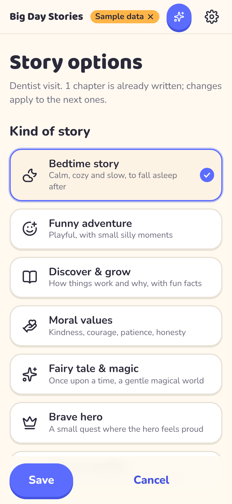<br><sub>Story options</sub></td>
  </tr>
</table>

<table>
  <tr>
    <td align="center">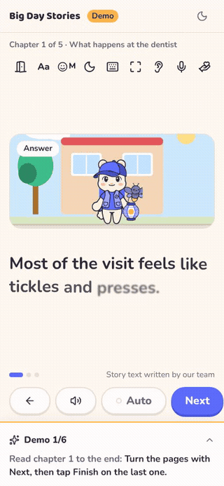<br><sub>A question changes the next page</sub></td>
    <td align="center">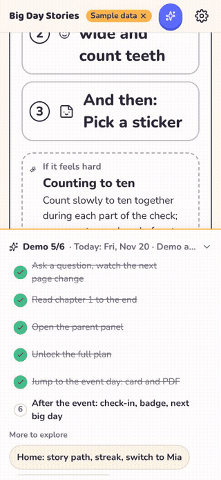<br><sub>Check-in and badge</sub></td>
    <td align="center">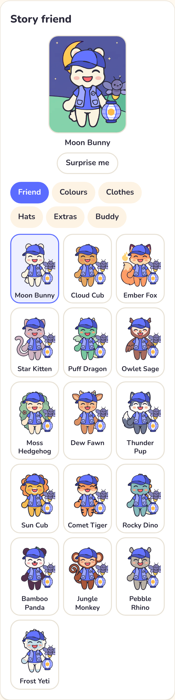<br><sub>16 story friends</sub></td>
  </tr>
</table>

<p align="center">
  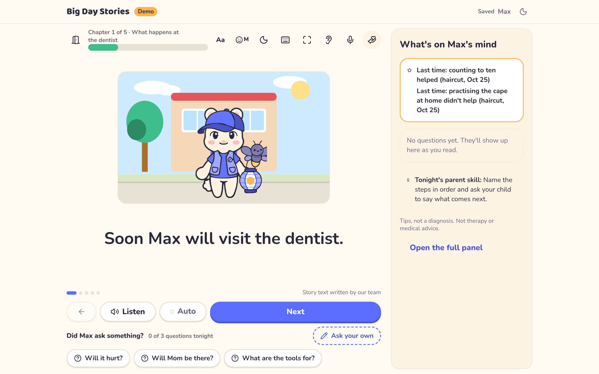<br>
  <sub>Reader on a laptop, with the parent panel on the right</sub>
</p>

<p align="center">
  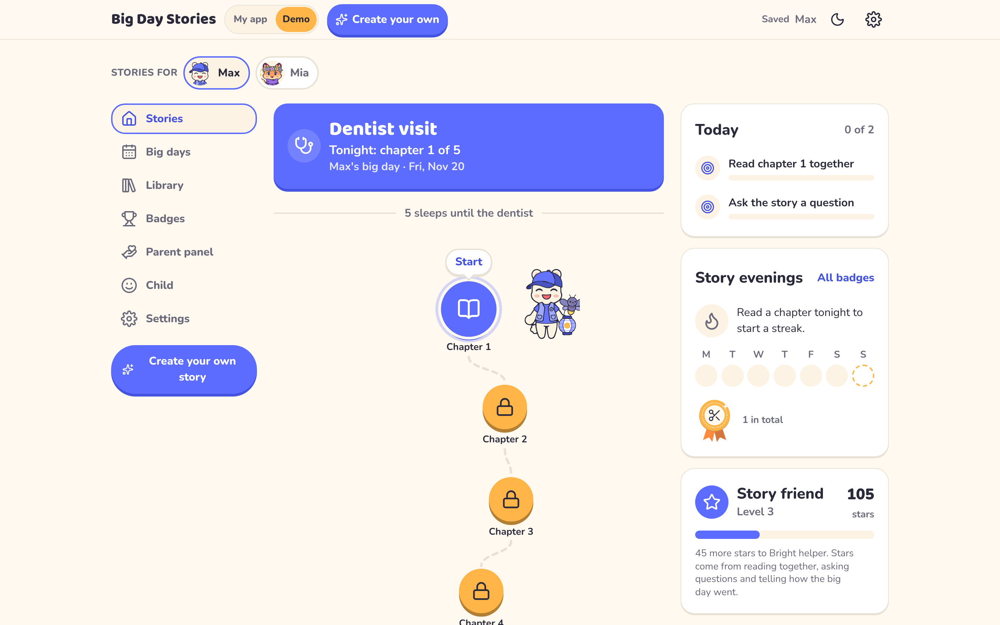<br>
  <sub>Home on a laptop: path, today's tasks, streak, story friend level</sub>
</p>

## For the jury: the whole product in 3 minutes

Open [bigdaystories.up.railway.app](https://bigdaystories.up.railway.app) and tap **Try a sample**. You get your own sample family (Max, 4, a dentist visit in 5 days and a past haircut), and a Demo bar at the bottom of every screen with a guided tour that ticks itself off:

1. While reading chapter 1, ask a question and watch the next page change.
2. Read chapter 1 to the end and tap **Finish**.
3. Open the parent panel.
4. Unlock the full plan: **Pay with the test card** (Stripe test mode, card 4242 4242 4242 4242, any future date, any CVC) or **Skip payment (demo access)**.
5. Jump to the event day: the "first, then" card and its printable A5 PDF.
6. Jump to after the event: the check-in, the badge, and the next big day with the form filled in.

**Evening 2**, **Event day** and **After the event** move the app's clock; **Reset demo** starts a clean sample for the next person.

To look around the whole app instead, tap **Or explore the whole app with sample data**: the same sample family opens on the home page, with Max and his sister Mia (her school plan started last night, so her path, streak and library already have something in them). The Demo bar's **More to explore** links lead to the home path, library, badges, the story friend, storyteller voices and the parent's own voice, the bedtime routine and the colour palettes. The sample is kept apart from a real family's data, and the **Sample data ×** badge leaves it.

To try it as a real parent, tap **Start for free** and describe your own big day.

## Business model

| Plan | Price | What it gives |
|---|---|---|
| Free | $0 | Chapter 1 of any big day, questions, the parent panel, calendar reminders, the check-in |
| **Big Day Pass** | **$9.99 once**, no auto-renewal | Every chapter and the event-day card for one big day, 90 days |
| **Gold** | **$49 a year** or $7.99 a month | Every big day for every child, the story remembers what helped |

Why families come back: a countdown and a chapter every evening, calendar reminders, the check-in and a badge, the next big day suggested with the form filled in, and a memory of what helps this child that grows with every event. Gross margin is above 90% (AI costs about $0.001 per full story). Market sizing, unit economics and the go-to-market plan are in [docs/pitch/business.md](docs/pitch/business.md).

## Architecture

```
Browser (parent's phone or laptop)        Server: one Next.js service on Railway        Outside
┌───────────────────────────────┐        ┌─────────────────────────────────────────┐
│ Screens (App Router, Tailwind) │  JSON  │ /api/chapter /api/answer /api/ritual    │──▶ LLM via OpenRouter
│ Story engine (pure code):      │◀──────▶│   filters → model → checks → fallback   │    (DeepSeek V4.1 Flash,
│   plan, clock, topics, access  │ stream │ /api/checkout /api/verify /api/portal   │     Haiku 5.5)
│ Stores (Zustand, localStorage) │        │ /api/family /api/state /api/sample      │──▶ Stripe (test mode)
│ Local-first sync module        │        │ /api/tts /api/voice-sample /api/push    │──▶ Speech models via OpenRouter
│ Speech: narrator and listener  │        │ /api/ics /api/health                    │
│ Service worker (PWA, offline)  │        │ Event templates (JSON), sessions,       │
└───────────────────────────────┘        │ rate limits, daily budget, cache        │
                                          └───────────────────┬─────────────────────┘
                                                              ▼
                                           PostgreSQL: families, family_state,
                                           entitlements, llm_calls
```

**Principles**

- **Code runs the product, the AI writes the words.** The plan, the story state, topics, memory, counters and paid access are computed by code. The model only writes text by rules and returns JSON that code validates against a schema. Product knowledge (what happens at the dentist, what helps, what to say) lives in 15 reviewed event templates.
- **Every AI call has a deadline and a template fallback**, so the whole cycle also works with the model switched off (`LLM_PROVIDER=mock`).
- **Local-first**: the browser keeps a working copy and the database keeps the durable copy. No login: a guest family is identified by a signed, httpOnly cookie.
- **Paid access is a database row** written by the server only after it verifies the Stripe session.

**Stack**

| Layer | Technology |
|---|---|
| UI | Next.js 16 (App Router), React 19, TypeScript, Tailwind CSS, Radix UI primitives, installable PWA |
| State | Zustand persisted to localStorage, IndexedDB for recordings, local-first sync with version checks |
| Database | PostgreSQL through Drizzle ORM, migrations applied on start; embedded PGlite for development |
| AI text | AI SDK with schema-validated streaming (zod) through OpenRouter: DeepSeek V4.1 Flash for chapters and day cards, Haiku 5.5 for answers and as the backup model. Models chosen by our own evaluation of quality, safety, speed and cost ([docs/llm-evaluation.md](docs/llm-evaluation.md)) |
| Voice | Device speech synthesis; premium voices (Kokoro, Fish Audio, ElevenLabs v3) and voice cloning through OpenRouter, cached on a volume |
| Payments | Stripe Checkout in test mode, server-side verification, webhook, customer portal |
| Calendar, PDF | `ics` package and Google Calendar link; jsPDF loaded on demand |
| Push | Web Push with VAPID keys |
| Hosting | Railway: one web service (root `web/`), PostgreSQL, a volume for audio |

Full specification: [docs/SPEC.md](docs/SPEC.md). One-page summary: [docs/architecture.md](docs/architecture.md).

## Reliability: what happens when something fails

| If this happens | The app does this |
|---|---|
| The AI model is slow | Each call has a deadline (first page 5 s, answer 3.5 s, day card 4 s). After it, a template page written by our team is shown, so the child never waits |
| The AI model fails or returns broken JSON | The output is validated against a schema; on any failure the template fallback is used and the page still answers the child's question |
| The provider fails twice in a minute | A circuit breaker switches to the backup model for 2 minutes; a `Retry-After` from the provider is respected |
| Spending grows | A hard daily dollar cap is enforced on the server and every call is logged with its cost in `llm_calls` |
| Too many requests | Limits per family (30 AI calls a minute), per IP (300 a minute, high enough for a whole jury on one Wi-Fi) and 3 questions per chapter |
| Premium voice is unavailable | The device voice reads the page instead; audio is cached, the next sentences are loaded ahead |
| The network drops | The PWA keeps working from the local copy and syncs with retries when the connection is back; a conflict keeps the newer copy |
| Stripe is not reachable | The paywall shows a clear message; access is granted only after the server verifies the payment, never by the browser |
| A health check is needed | `GET /api/health` reports every dependency as ok, off, degraded or down with the fallback in use; Railway restarts the service on failure |

The full table of failures, edge cases and fallbacks (AI, voice, voice clone, pictures, Stripe, database, push, offline, iOS Safari, odd input) is in [docs/reliability.md](docs/reliability.md).

## Safety and privacy

**Five levels of protection for what the child sees**

1. **Filters before the model**: the child's name, phone numbers, emails, links and addresses are removed; unsafe and sensitive questions are recognised by code.
2. **Provider safety settings** on every model call.
3. **System prompt rules**: no false promises ("it won't hurt at all"), no medical advice, age-appropriate words.
4. **Checks after the model**: stop phrases, dosages, links, contacts, invented names and profanity are caught before anything is shown.
5. **Parent check**: a sensitive question is never answered to the child by the AI; the parent sees a draft and decides. An unsafe question gets a fixed kind message and a help line for the adult.

A safety test set of 65 questions runs with `npm run safety` ([docs/safety-report.md](docs/safety-report.md)).

**Privacy by design (US law and best practice)**
- Only a first name or nickname, never a surname. **The child's name is never sent to the text AI**: it is replaced by a placeholder and put back on the device.
- No account and no email needed; the parent can export or delete everything.
- The parent's voice sample is used only with consent and deleted in one tap; story audio is kept for at most 30 days.
- The parent gate protects the parent panel and settings. The app is labelled as not therapy or medical advice.
- See the in-app Privacy and Terms pages.

## Run it locally

Requirements: Node.js 22, npm. No database or keys are needed for a first run.

```bash
cd web
cp .env.example .env.local    # set LLM_PROVIDER=mock to run with no keys and no cost
npm install
npm run dev                   # http://localhost:3000
```

With `DATABASE_URL` empty, an embedded PostgreSQL (PGlite) is created in `web/.data/`. Without a Stripe key, payments run in a mock mode in development.

Main variables (full list with comments in [web/.env.example](web/.env.example)):

| Variable | What it does |
|---|---|
| `LLM_PROVIDER` | `openrouter`, `gemini` or `mock` (no key, text from templates) |
| `OPENROUTER_API_KEY`, `OPENROUTER_MODEL`, `OPENROUTER_MODEL_ANSWER`, `OPENROUTER_MODEL_BACKUP` | Text models for chapters, answers and the backup |
| `LLM_BUDGET_USD_PER_DAY` | Hard daily spending cap enforced by the server |
| `DATABASE_URL` | PostgreSQL connection string; empty means the embedded database |
| `STRIPE_SECRET_KEY`, `STRIPE_WEBHOOK_SECRET` | Stripe test mode (a live key is refused) |
| `ENTITLEMENT_SECRET` | Signs the family session cookie |
| `DEMO_MODE` | `on` shows the jury tour and demo access in the sample |
| `TTS_MODEL`, `TTS_VOICES`, `TTS_CACHE_DIR` | Premium storyteller voices and their audio cache |
| `VAPID_PUBLIC_KEY`, `VAPID_PRIVATE_KEY` | Web push reminders (`npm run vapid` creates them) |

Other commands: `npm run build` and `npm start` (production), `npm run typecheck`, `npm run lint`, `npm test`. More in [web/README.md](web/README.md).

## Deploy

Production runs on **Railway**: one web service from this repository with root directory `web/`, a PostgreSQL service, and a volume mounted at `/data` for cached audio (`TTS_CACHE_DIR=/data/tts`). Database migrations run automatically on start, the health check is `/api/health`, and every push to `main` that touches `web/` redeploys. Secrets are set only in Railway variables; none are stored in the repository.

## Tests

- **255 unit and API tests** (Vitest) on the story engine, safety filters, AI fallbacks, payments, sync and API routes: `npm test`.
- **Safety evaluation**: `npm run safety` (65 questions, written to [docs/safety-report.md](docs/safety-report.md)).
- **Model evaluation**: `npm run eval` compares models on 16 story scenarios, 16 day cards and 16 safety questions ([docs/llm-evaluation.md](docs/llm-evaluation.md)).
- TypeScript strict mode, ESLint, and a check that the zod schemas match the engine types.

## Repository layout

| Folder | What is inside |
|---|---|
| `web/app/` | Screens and API routes (Next.js App Router) |
| `web/components/` | Reader, parent panel, home, paywall, event day, avatar builder, shared UI |
| `web/lib/engine/` | The story engine: plan, clock, topics, memory, access rules |
| `web/lib/llm/`, `web/lib/safety/` | AI calls with deadlines, fallbacks, circuit breaker, budget; the five safety levels |
| `web/lib/payments/` | Stripe gateway, plans, access rows |
| `web/lib/sync/`, `web/lib/store/` | Local-first sync and browser stores |
| `web/content/events/` | The 15 event templates |
| `web/tests/`, `web/evals/` | Unit and API tests; safety and model evaluations |
| `docs/` | Specification, architecture, decisions, research, pitch materials, media |

## Documentation

| File | What it holds |
|---|---|
| [docs/SPEC.md](docs/SPEC.md) | Full specification: flows, screens, engine, data, AI and safety, API, payments, deploy |
| [docs/architecture.md](docs/architecture.md) | One-page architecture |
| [docs/decisions.md](docs/decisions.md) | Dated decision log |
| [docs/pitch/business.md](docs/pitch/business.md) | Market, competitors, pricing, unit economics, go-to-market |
| [docs/pitch/](docs/pitch/) | Pitch deck, speaker script, answers to jury questions |
| [docs/llm-evaluation.md](docs/llm-evaluation.md), [docs/safety-report.md](docs/safety-report.md) | Model choice and safety results |
| [docs/media/](docs/media/) | Screenshots, GIFs and walkthrough videos of the live app |
